# ET 617 End-Semester Examination — Report

# मेरा या मेरी? (Mera ya Meri?)
*A 10-minute Hindi gender-agreement practice app for first-generation learners on shared tablets*

---

## Identity card

| Field | Value |
|---|---|
| **Roll number (ID)** | **23B2215** |
| **P – Problem** | P2 – Contextual language and literacy application (NLP · Language learning · Localisation) |
| **T – Topic** | P2-T2 – Hindi: gender agreement (लिंग) in verbs and adjectives |
| **L – Learner context** | L2 – First-generation learner in an urban low-income settlement, attends an NGO after-school centre with shared tablets |
| **C – Design constraint** | C4 – 10-minute sessions |
| **Live app** | https://et617-23b2215.vercel.app |
| **Repository** | https://github.com/AagamKas/et617-endsem-23B2215 |
| **Starter / libraries** | `npm create vite` (template: react), Tailwind CSS v4. No UI component library. Hosted on Vercel. |

---

## D1 – Educational problem

Children in Hindi-medium government schools in urban settlements often speak a regional variety at home (here, Bhojpuri-influenced Hindi), where verbs carry much less gender marking than in standard Hindi. A common, persistent error is **gender agreement (लिंग)**: the adjective and verb must change to match the noun (*पानी ठंडा है* but *किताब अच्छी है*; *घोड़ा आया* but *बस आई*). Teachers mark these errors in red without explaining them, and NGO volunteers cannot give each child one-to-one feedback; the children get only about 10 minutes each on a shared tablet. **मेरा या मेरी?** gives each child a short, self-paced, feedback-rich sequence that diagnoses *why* they make the error and resumes exactly where they stopped.

**Learning outcomes.** After one session the learner will be able to:
1. **O1 – Identify** the grammatical gender of common Hindi nouns, including ones that break the "-आ = masculine, -ई = feminine" pattern (पानी, दही are masculine; किताब, बस are feminine) — at least 5 of 6 nouns sorted correctly.
2. **O2 – Choose and produce** the correct adjective and verb ending (-आ/-ई, -या/-ई, -ता/-ती, रहा/रही) to agree with the noun, in tap, typed and spoken answers — at least 4 of 5 production items right.
3. **O3 – Explain** why a sentence is correct by naming the noun whose gender decides the ending (e.g. "बस स्त्रीलिंग है, इसलिए आई").

**Context of use.** An NGO after-school centre in a Delhi resettlement colony, 4–6 PM, 3–4 days a week. One child uses a shared 8-inch Android tablet (Chrome) for about 10 minutes while others do worksheets; a volunteer "didi" rotates turns. The room is noisy, there are no headphones, and Wi-Fi is patchy.

---

## D2 – Learner persona: Rani Kumari

| | |
|---|---|
| **Name / age** | Rani Kumari, 11, Class 6, government Hindi-medium school, Sangam Vihar, South Delhi |
| **Family** | First-generation learner. Parents migrated from Siwan, Bihar, 8 years ago; father a daily-wage construction worker, mother a domestic worker; both read only a little. Younger brother (7). No storybooks or newspapers at home. |
| **Where she learns** | NGO after-school centre, 4–6 PM; ~25 children share 5 tablets; a volunteer didi runs 10-minute turns. |
| **Language** | Bhojpuri-influenced Hindi at home: says *"हम जा रहे हैं"* for "I am going" (girls also use the -ते form with हम, so this is a dialect feature, not a gender error); drops the nukta in speech (*जरूर*, *रोज*). Standard Hindi at school. Reads Devanagari slowly, understands far better by ear. |
| **Prior knowledge of prerequisites** | ✅ All letters and matras; reads/writes short sentences slowly. ✅ Everyday nouns (पानी, किताब, बस, रोटी, दीदी); uses मेरा/मेरी correctly for *people*. ✅ Has heard पुल्लिंग/स्त्रीलिंग but cannot explain them. ❌ Never taught that adjectives *and* verbs agree with the noun, or that objects have grammatical gender. ❌ Confuses short इ and long ई matras (*आइ* for *आई*). |
| **Misconception M1** | *"Every -ई word is feminine, every -आ word is masculine."* Writes **पानी ठंडी है**, **दही खट्टी है**. Origin: overgeneralises the लड़का/लड़की pattern to word endings. |
| **Misconception M2** | *"Objects are masculine unless obviously female."* Writes **किताब अच्छा है**, **बस आया**. Origin: learned gender only through people; Bhojpuri verbs mark gender less, so she rarely hears agreement at home. |
| **Device / time** | Shared Android tablet, Chrome, patchy Wi-Fi, noisy room, no headphones. ~10 minutes per turn, 3–4 days a week; often interrupted when the didi calls the next child. |
| **Motivation** | Wants to write "proper Hindi like didi" and stop getting red marks. Loves stars and praise; embarrassed by public correction; prefers speaking to writing. |

**How the persona shaped the design:** reads slowly → 🔊 on every prompt and feedback, pictures, short sentences · noisy shared device → audio optional, typed/tap fallback, per-child profiles · interrupted 10-minute turns → timer, auto-save, pause/resume · embarrassed by correction → hint first, explanation second, no harsh "wrong" · home dialect → accepted and bridged, never marked wrong · knows मेरा/मेरी for people → the "मेरा या मेरी?" trick (the app's name) as a self-check tool.

---

## D3 – Educational content (one complete learning activity)

### Concept explanation (screen "चलो समझते हैं")
Three picture cards, read aloud on tap, with the agreeing ending highlighted (**-आ blue**, **-ई pink**):
1. 👦 👧 *लड़का अच्छा है। लड़की अच्छी है।* — 💡 लड़का → -आ, लड़की → -ई
2. 🐎 🚌 *घोड़ा आया। बस आई।* — 💡 चीज़ों का भी लिंग होता है! बस स्त्रीलिंग है।
3. 💧 📕 *पानी ठंडा है। मेरी किताब अच्छी है।* — 💡 पानी के अंत में -ई है, फिर भी पुल्लिंग!

**Rule (kept jargon-free):** 📌 *जिसकी बात हो रही है, उसी से शब्द का अंत बदलता है।* (small print: संज्ञा का लिंग → विशेषण और क्रिया का अंत)

### Tasks (7 tasks, 6 formats) with model answers

| # | Format | Task | Model answer | Targets |
|---|---|---|---|---|
| 1 | Multiple choice | 💧 *पानी ___ है।* ठंडा / ठंडी | **ठंडा** | M1, O2 |
| 2 | Multiple choice | 📕 *मेरी किताब बहुत ___ है।* अच्छा / अच्छी | **अच्छी** | M2, O2 |
| 3 | Sorting (drag-and-drop or tap) | पानी, किताब, घोड़ा, बस, दही, नदी → पुल्लिंग (मेरा …) / स्त्रीलिंग (मेरी …), with a worked example (👦 लड़का → मेरा लड़का) | **पुल्लिंग:** पानी, घोड़ा, दही · **स्त्रीलिंग:** किताब, बस, नदी | O1, M1+M2 |
| 4 | Typed correction (on-screen Hindi keyboard / Roman→Hindi) | ~~बस आया।~~ → write it correctly | **बस आई।** | O2, M2, spelling |
| 5 | Reasoning choice ("क्यों?") | *"बस आया" को हमने "बस आई" क्यों किया?* (a) क्योंकि "बस" स्त्रीलिंग है — "मेरी बस" (b) क्योंकि वाक्य लिखने वाली लड़की है (c) क्योंकि "आई" लिखना ज़्यादा सुंदर लगता है | **(a)** | O3 |
| 6 | Word tiles | 👧⚽ build from: रहा · लड़की · है · खेल · रही | **लड़की खेल रही है** | O2 |
| 7 | Spoken answer (speech in, speech out) | 🏫 *तुम रोज़ स्कूल कैसे जाती हो?* | **मैं रोज़ स्कूल जाती हूँ।** (accepted dialect: *हम रोज स्कूल जाते हैं*) | O2, design challenge |
| ➕ | "One more of this type" (learner's choice, **max 3 per session** to stay within 10 min) | *हाथी बहुत ___ है* (मोटा/मोटी) · *मेरी कलम ___ है* (नया/नई) · sort घी, कलम, हाथी, सड़क, आदमी, चाय · fix *सड़क टूटा है* · why *पानी ठंडी → ठंडा?* · tiles *दीदी खाना बना रही है* · speak *तुम्हारी दीदी शाम को क्या करती है?* | मोटा · नई · पुल्लिंग: घी, हाथी, आदमी / स्त्रीलिंग: कलम, सड़क, चाय · सड़क टूटी है · "पानी पुल्लिंग है" · दीदी खाना बना रही है · दीदी खाना बनाती है | learner agency, extra practice |
| + | Remedial (only if diagnosed) | M1: *दही ___ है।* खट्टा/खट्टी · M2: *सड़क बहुत ___ है।* लंबा/लंबी · other: *लड़का खेल ___ है।* रहा/रही | खट्टा · लंबी · रहा | adaptivity |

### Feedback (actual text shown and spoken by the app)
Feedback has two levels: **level 1 = hint** (the learner finds her own error; no answer given), **level 2 = explanation + model answer**.

| Case | Feedback |
|---|---|
| **Correct** (task 1) | ✅ *शाबाश! ✓ "पानी" पुल्लिंग है, इसलिए यही सही है।* ⭐⭐ पहली बार में सही! |
| **M1** (chose ठंडी) — hint | 🟡 *"पानी" के अंत में -ई है… पर क्या हर -ई वाला शब्द स्त्रीलिंग होता है? बोलकर देखो: "मेरा पानी" या "मेरी पानी"?* |
| **M1** — explanation | 🔴 *"पानी" के अंत में -ई है, पर यह पुल्लिंग है! इसलिए "ठंडा" आएगा, "ठंडी" नहीं।* सही उत्तर: पानी ठंडा है। |
| **M1** — re-teach card | *हर -ई वाला शब्द स्त्रीलिंग नहीं होता!* ठंडा पानी 💧 · खट्टा दही 🥣 · मोटा हाथी 🐘 · अच्छा आदमी 👨 · सफ़ेद मोती ⚪ — 🪄 तरकीब: "मेरा पानी" ✓, "मेरी पानी" ✗ |
| **M2** (chose अच्छा) — hint | 🟡 *क्या चीज़ें हमेशा पुल्लिंग होती हैं? बोलकर देखो: "मेरा किताब" या "मेरी किताब"?* |
| **M2** — explanation | 🔴 *चीज़ों का भी लिंग होता है! "किताब" स्त्रीलिंग है (मेरी किताब)। इसलिए "अच्छी" आएगा, "अच्छा" नहीं।* |
| **M2** — re-teach card | *चीज़ों का भी लिंग होता है!* अच्छी किताब 📕 · बस आई 🚌 · लंबी सड़क 🛣️ · गरम चाय ☕ · मेरी कलम 🖊️ |
| **Spelling** (typed बस आइ) | 🟡 *लगभग सही! बस वर्तनी (spelling) ठीक करो।* — *"आइ" नहीं, "आई" — यहाँ बड़ी ई (ई) लगती है।* |
| **Reasoning (b)** — hint / explanation | *क्या शब्द का अंत लिखने वाले से बदलता है, या जिसकी बात हो रही है उससे?* → *शब्द का अंत लिखने वाले से नहीं, जिसकी बात हो रही है उससे बदलता है — यहाँ "बस" की बात है, और बस स्त्रीलिंग है।* |
| **Dialect** (said *हम रोज स्कूल जाते हैं*) | ✅ *बिल्कुल ठीक! ✓ घर की बोली में "हम जाते हैं" बिल्कुल सही है।* + blue tip: *📝 स्कूल की हिंदी में (एक टिप, गलती नहीं): अगर सिर्फ़ अपनी बात हो, तो लिखते समय ऐसे लिखते हैं: मैं रोज स्कूल जाती हूँ।* |
| **Pronunciation** (रोज for रोज़) | 🗣️ *"रोज" और "रोज़" — दोनों ठीक हैं।* |

Stars: ⭐⭐ right first time · ⭐ right after the hint · none after the model answer (with *💪 कोशिश के लिए शाबाश!*).

---

## D4 – Working application

**URL:** https://et617-23b2215.vercel.app · ID **23B2215** in the footer of every screen and on the About screen.

### Screen map
```
[S1 Profiles: "यह टैबलेट सबका है"] ──pick/create──▶ [S2 Home + progress chart]
   │  create (name in Hindi/English, avatar,          │ ▶ start / resume ("जहाँ छोड़ा था")
   │  "मैं जाता/जाती हूँ"), delete, reset app          ▼
   │                                         [S3 Learn: 3 cards + rule]
   │                                                  ▼
   │                                  [S4 Task (6 formats)] ──answer──▶ [S4a Feedback state]
   │                                     ▲   correct ✓ / hint 🟡 → retry / explanation 🔴 / dialect ✓+bridge
   │                                     │                         │ misconception diagnosed
   │                                     └──── next task ◀── [S5 Re-teach card] ──▶ targeted remedial task
   │                                                  ▼
   │            ⏸ pause → S2 · ⏹ end → S6      [S6 Summary: stars, progress chart, today's rule]
   └──────────◀── "खत्म — अगला बच्चा" ◀──────────────┘          [S7 About] (from footer, any screen)
```
**Learner inputs:** tap choice, drag-and-drop, typed Hindi (on-screen keyboard, Roman→Devanagari), word tiles, speech. **System outputs:** two-level feedback, spoken feedback, re-teach cards, inserted remedial tasks, progress chart, stars.

**Selected screens:**

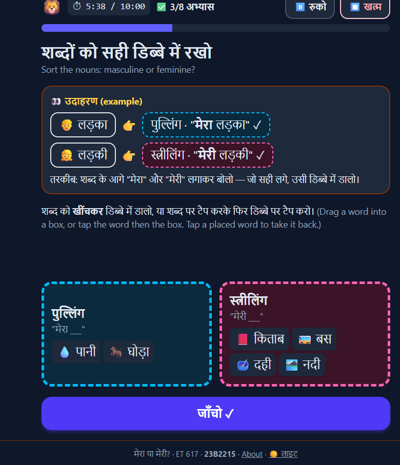

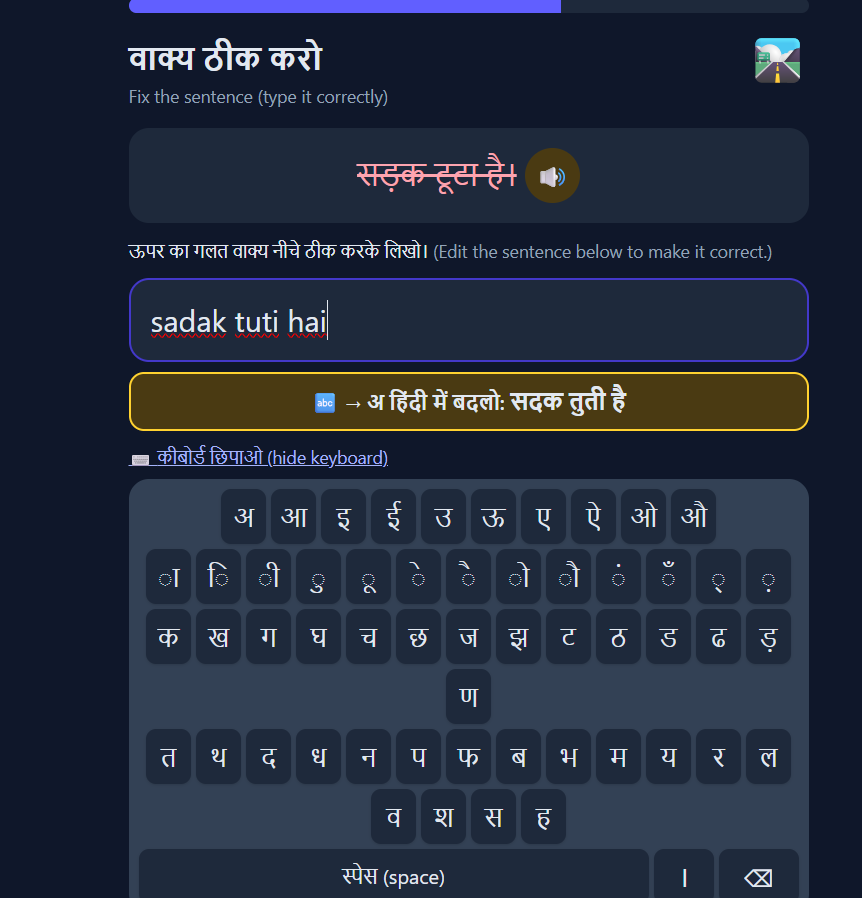

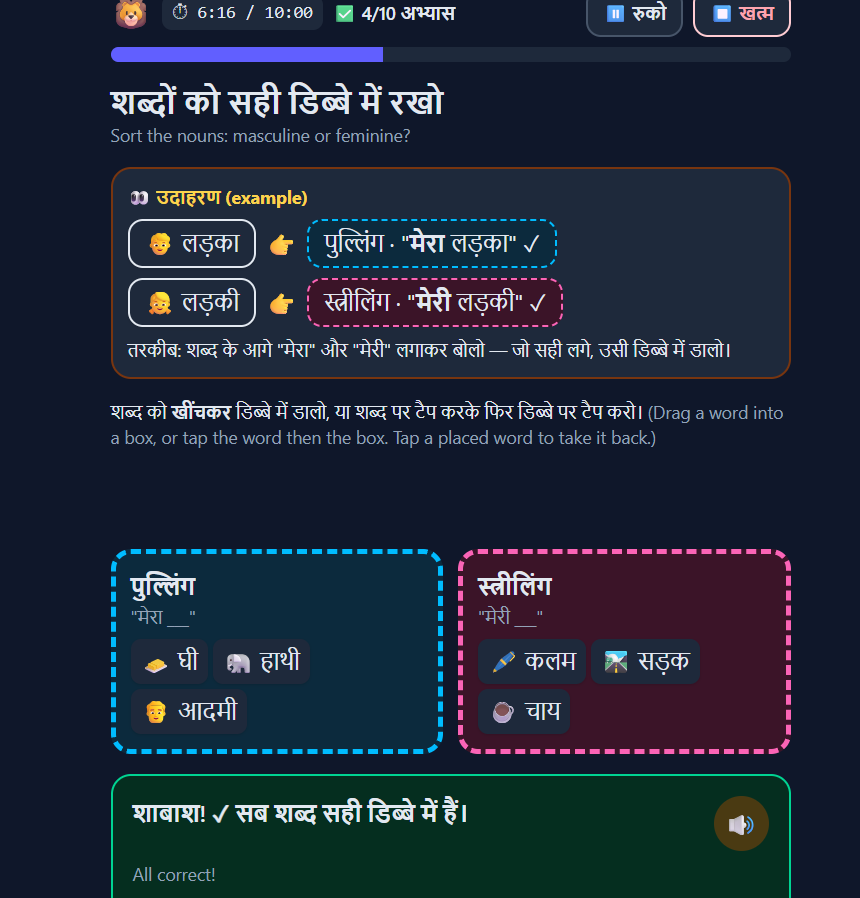

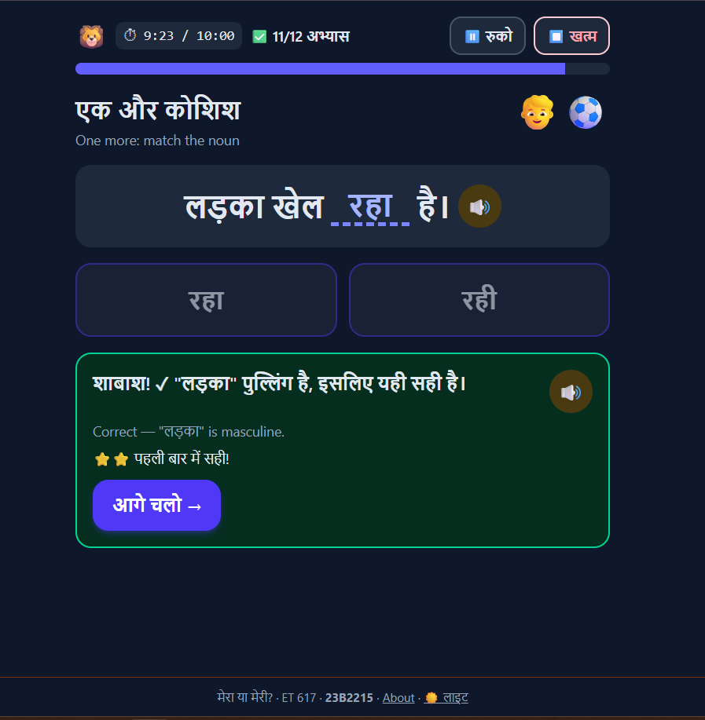

### C4 (10-minute sessions) — visible implementation
- ⏱ **"x:xx / 10:00" timer** and an **"✅ x/y अभ्यास" exercises-completed counter** with progress bar on every session screen;
- Extra "one more of this type" practice is **capped at 3 per session** so the sequence still fits in 10 minutes; one sequence (explain + 7 tasks + recap) takes ≈ 8–9.5 minutes.
- **Auto-save** every second and after each step (localStorage, per child).
- **⏸ रुको** (pause) and **▶ जहाँ छोड़ा था, वहीं से** (resume at the same step), even after another child used the tablet.
- **⏹ खत्म** (end session, with confirmation) → summary with unfinished steps marked ⬜.
- Gentle notice at 10:00: *⏰ 10 मिनट पूरे! तुम रुक सकते हो — अगली बार यहीं से शुरू करेंगे।*

---

## D5 – Two contrasting learner scenarios (run on the live app)

All screenshots were taken on the live app (dark mode), with ID 23B2215 in the footer.

### (a) Learner who responds correctly
For *पानी ___ है* she chooses **ठंडा** → ✅ *शाबाश! ✓ "पानी" पुल्लिंग है, इसलिए यही सही है।* with ⭐⭐ and **no extra items**; she moves straight on (or may choose "➕ इसी तरह का एक और").

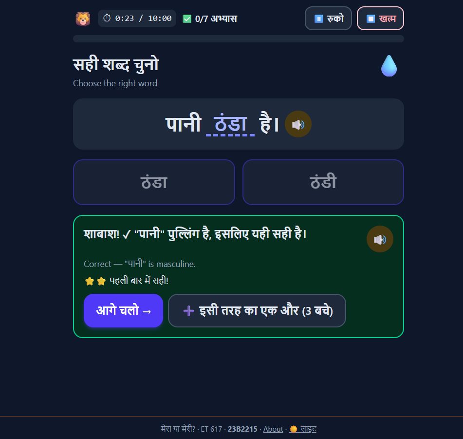

Typed correction: she writes **बस आयी।** (an accepted spelling variant of आई) → ✅ *"बस" स्त्रीलिंग है, इसलिए यही सही है।*

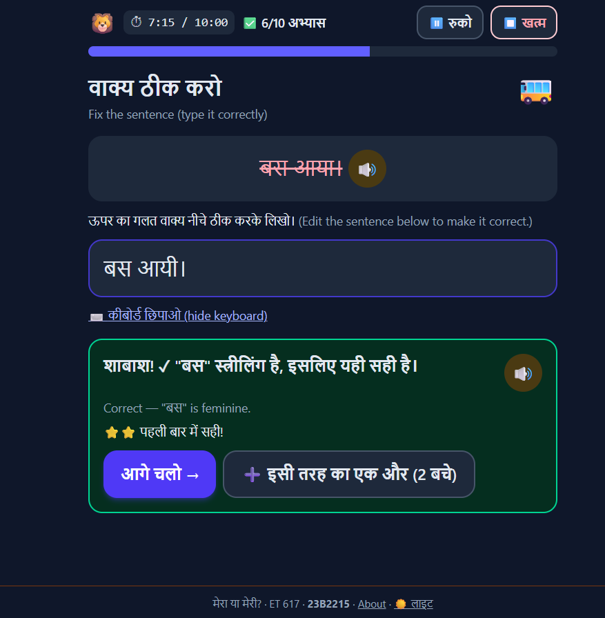

### (b) Learner showing misconception M2 ("objects are masculine")
For *मेरी किताब बहुत ___ है* she chooses **अच्छा**.
1. **Hint, no answer given** — 🟡 *क्या चीज़ें हमेशा पुल्लिंग होती हैं? बोलकर देखो: "मेरा किताब" या "मेरी किताब"?*

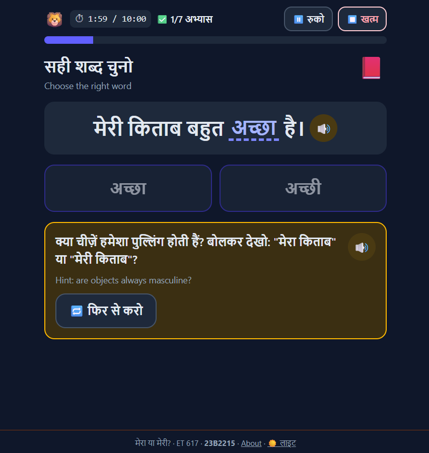

2. She retries and chooses **अच्छा** again → 🔴 **explanation + model answer**: *चीज़ों का भी लिंग होता है! "किताब" स्त्रीलिंग है (मेरी किताब)। इसलिए "अच्छी" आएगा, "अच्छा" नहीं।* — सही उत्तर: मेरी किताब बहुत अच्छी है। (no stars, *💪 कोशिश के लिए शाबाश*)

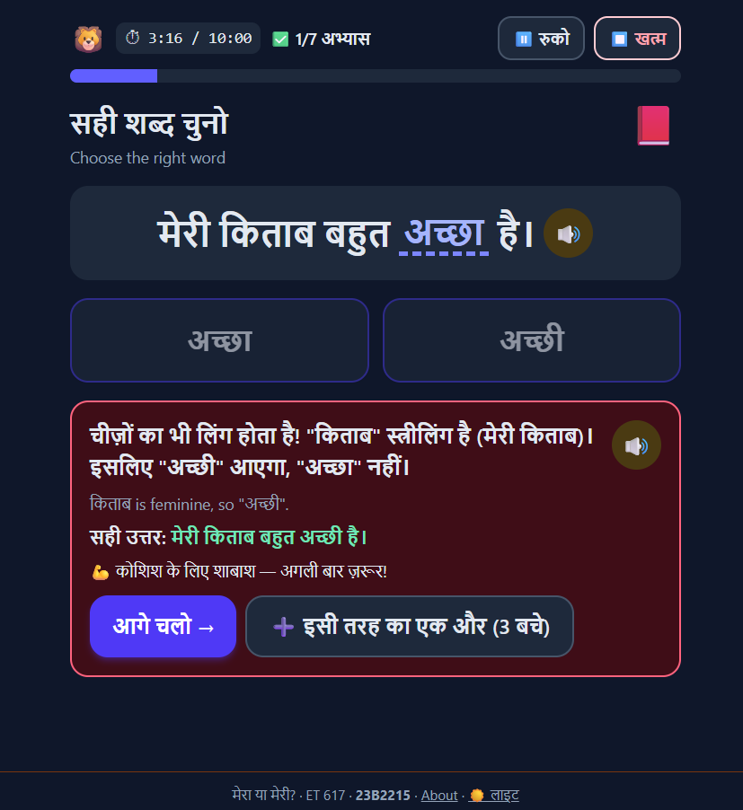

3. The system **diagnoses M2 and inserts a re-teach card** (*चीज़ों का भी लिंग होता है!* with five feminine objects and the "मेरा/मेरी" trick), followed by a targeted extra item (*सड़क बहुत ___ है*). Note the exercise count grows from 7 to 8.

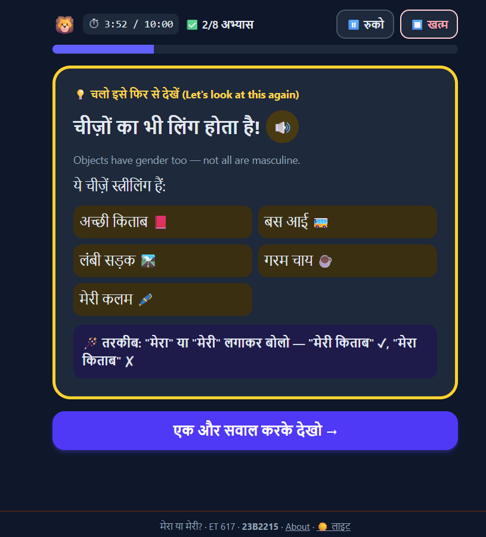

**The same learner also showed M1** in the sorting task (placed **दही** under स्त्रीलिंग because it ends in -ई) → M1 hint → M1 re-teach card *"हर -ई वाला शब्द स्त्रीलिंग नहीं होता!"*:

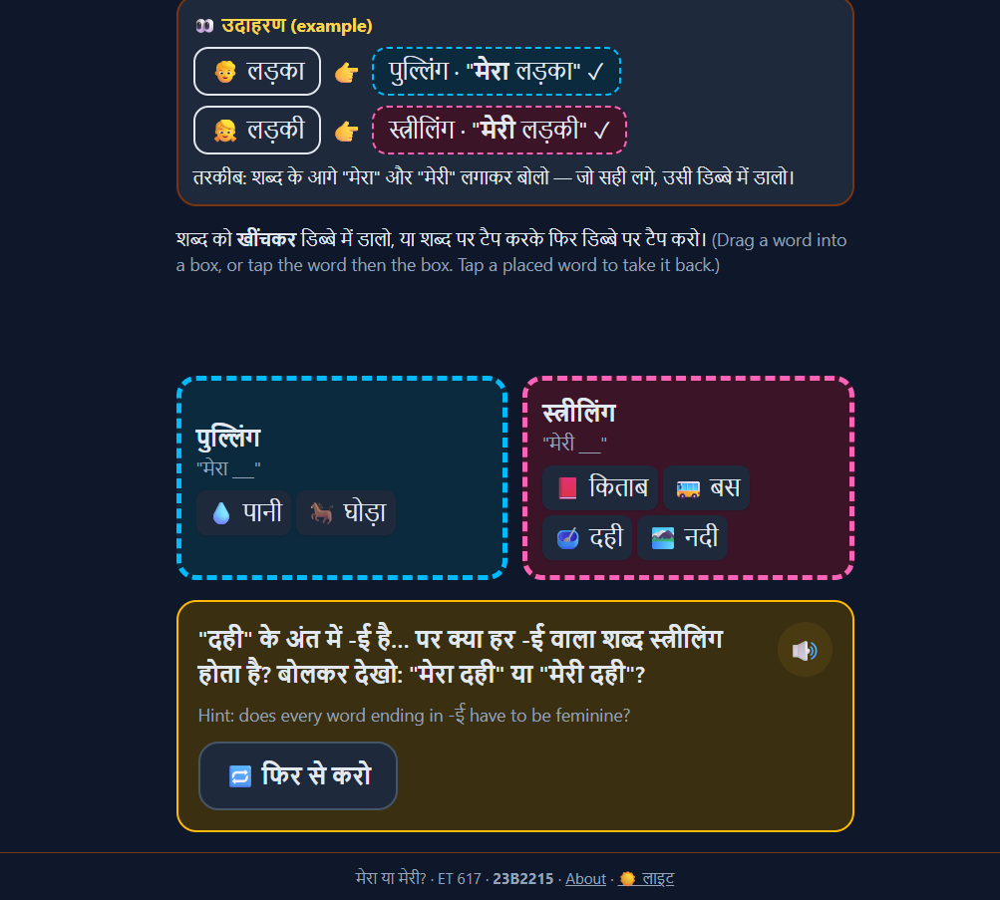
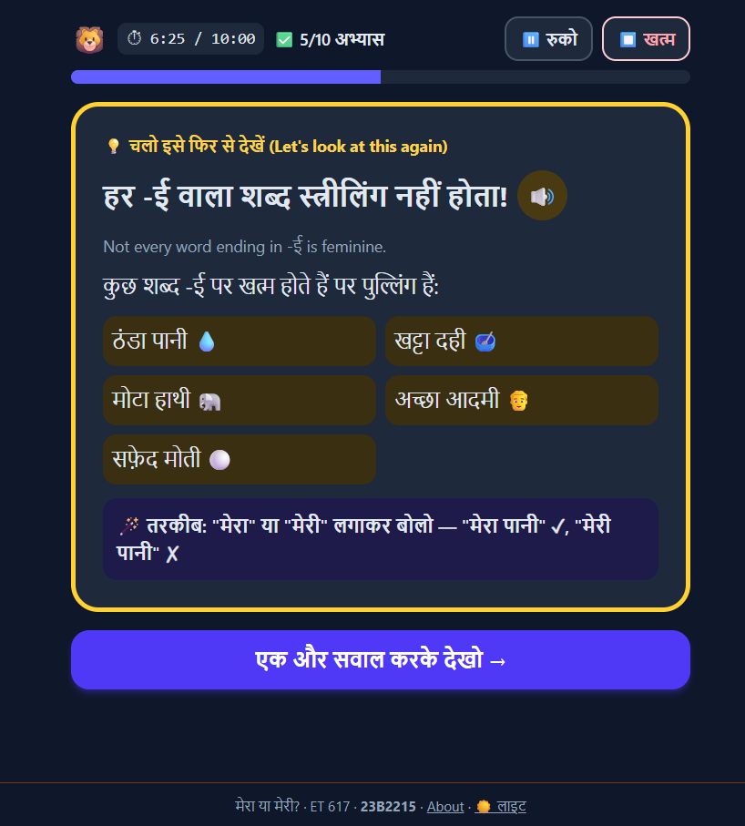

### Outcome of the two paths
Path (a) gets praise and moves on; path (b) gets a hint → explanation → re-teach card → extra targeted items, and her summary shows 🟡 on those tasks, 🔁 inserted review items, and lower first-try bars for O1/O2 (3/4, 4/7) — data a teacher can act on. Her next session will open with M1/M2 warm-up items.

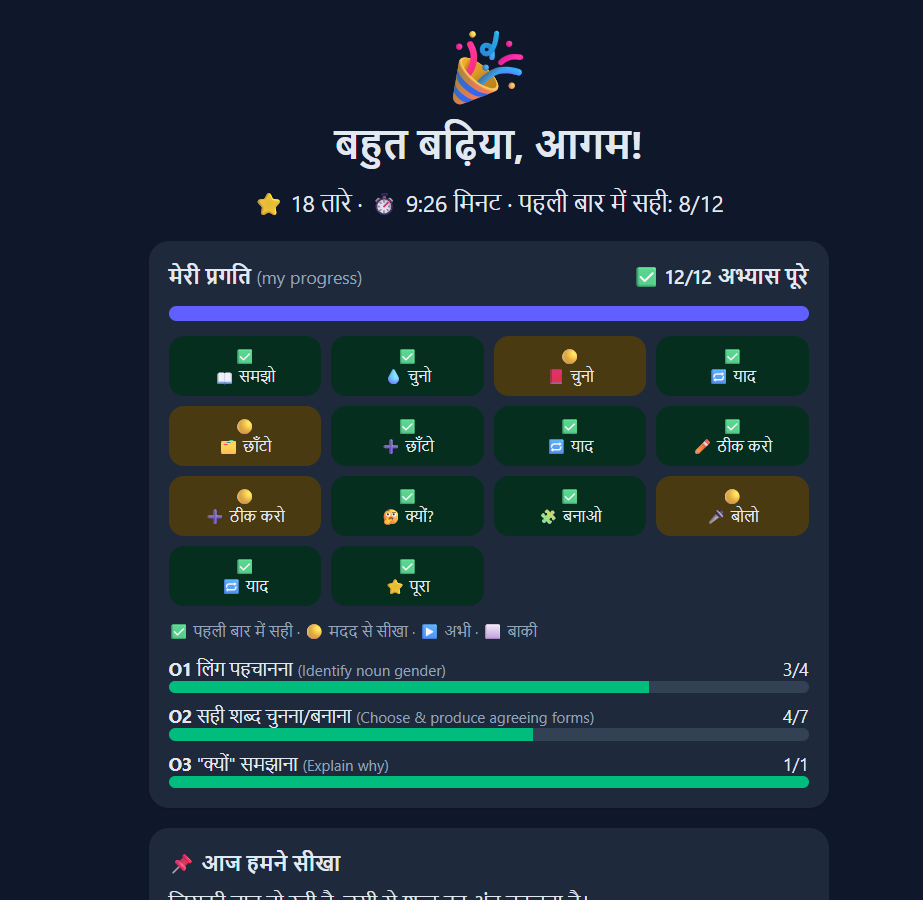

### Design-challenge demonstration: dialect accepted, not marked wrong
Typed answer on the speaking task: **हम बस से जाते है** (Bhojpuri-influenced हम for "I") → ✅ *बिल्कुल ठीक!*, ⭐⭐, the note *घर की बोली में "हम जाते हैं" बिल्कुल सही है। (Dialect variation, accepted — not an error.)* and a separate blue "school Hindi" tip that is explicitly *एक टिप, गलती नहीं*. Contrast with path (b), where a real agreement error gets a hint and an explanation.

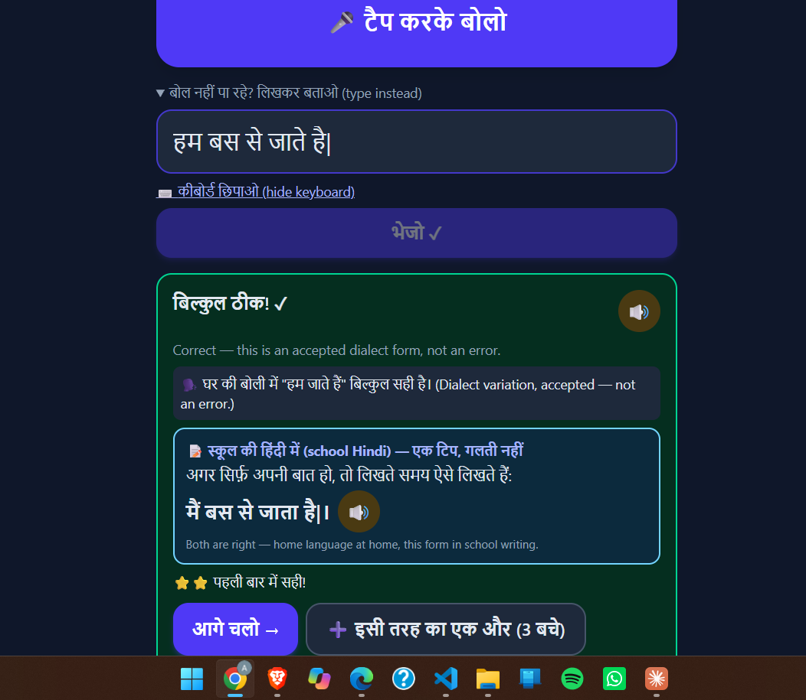

*Note:* this screenshot exposed a bug in the tip: it showed "मैं बस से जाता है|।" because singular है and a typed "|" were not converted. Fixed before submission; the tip now reads **"मैं बस से जाता हूँ।"**.

### Design-challenge demonstration (speaking task)
*हम रोज स्कूल जाते हैं* → ✅ accepted as dialect + blue "school Hindi" tip (not an error); *मैं स्कूल जाता हूँ* for a learner who chose "मैं जाती हूँ" → 🟡 agreement hint. The speaking screen shows the learner's chosen self-reference form ("तुमने चुना: मैं जाता हूँ — बदलना है?") so it can be corrected on the spot:

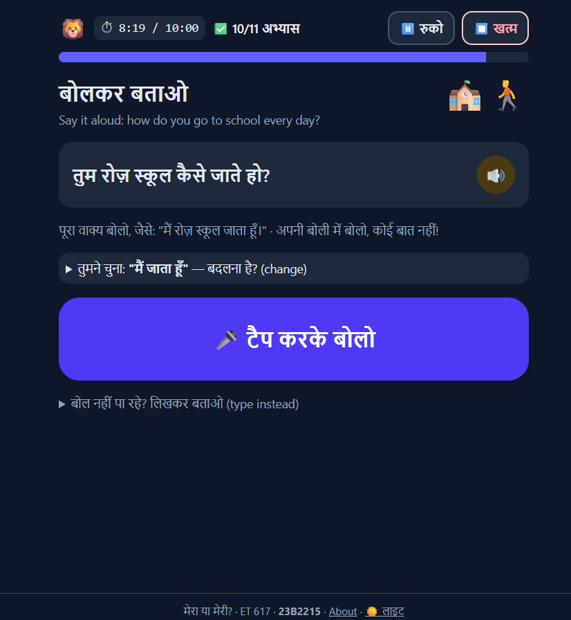

---

## D6 – AI / NLP functionality specification

No large language model is used (no API key was available, and deterministic checking avoids unverified AI feedback reaching an 11-year-old). The NLP features are:

### 6.1 Hindi gender-agreement checker (`src/nlp.js`, `checkAgreement(text, learnerGender)`)
- **What it does:** decides whether the adjectives/verbs/possessive in a Hindi sentence agree in gender with its subject, and classifies the answer.
- **Input:** the learner's sentence (built from a choice, typed, tiles, or speech transcript) and the learner's self-reference form (जाता/जाती). Example call: `checkAgreement('पानी ठंडी है', 'f')`.
- **Processing:** (1) **normalise** — Unicode NFD, remove nukta (ज़→ज, ड़→ड), chandrabindu→anusvara, strip punctuation; (2) **find the subject** — first word that is a pronoun (मैं/हम/…) or in a 32-noun gender lexicon (`पानी: m`, `किताब: f, inanimate`…); (3) **find agreeing words** — the possessive/adjective right before the subject and gender-marked words after it, skipping nouns, auxiliaries (है/हूँ) and bare verb stems (जा, खेल…); (4) **read gender from the ending** (-ा/-या → m, -ी/-ई → f, -े → plural/respect).
- **Output:** `{ type: 'ok' | 'dialect' | 'M1' | 'M2' | 'agreement' | 'unknown', subject, gender, wrong, fix, notes, bridge }`. Example: `पानी ठंडी है` → `{ type: 'M1', subject: 'पानी', wrong: 'ठंडी', fix: 'ठंडा' }`.
- **Classification rules:** masculine noun ending in -ई + feminine form → **M1**; inanimate feminine noun + masculine form → **M2**; हम + -ते/-े forms → **dialect** (accepted); other mismatch → **agreement**.
- **How output is checked before the learner sees it:** for closed tasks the expected answer is fixed in the content (`answer: 'ठंडा'`), so correctness never depends on the checker alone — the checker only chooses *which* feedback to show. The checker has **16 regression tests** (`npm test`, `tests/nlp.test.mjs`) covering correct, M1, M2, agreement, dialect and pronunciation-variant sentences; a bug (bare stems like जा read as masculine) was found by these tests and fixed during the exam.
- **Fallback when it fails or is wrong:** if no subject is found → *"हमें वाक्य में संज्ञा नहीं मिली। पूरा वाक्य बोलो या लिखो।"*; after two tries the model answer is always shown, so a mis-classification can never block progress.

### 6.2 Spelling feedback
- Detects the इ/ई confusion in the target verb (`/आइ/` → *"आइ" नहीं, "आई" — यहाँ बड़ी ई लगती है*). Output: a spelling-specific hint, not an agreement error.

### 6.3 Speech recognition (speaking task)
- **What:** converts Rani's spoken answer to text. **Call:** browser Web Speech API — `new webkitSpeechRecognition()`, `lang = 'hi-IN'`, `interimResults = false`, `maxAlternatives = 1`. **Output:** a transcript shown as *तुमने कहा: "…"*, then passed to the checker.
- **Check:** the transcript is shown to the learner, normalised (nukta-insensitive, so *रोज/रोज़* both pass) and judged by the deterministic checker, never trusted blindly.
- **Fallback:** unsupported browser (Firefox, Brave) or mic/network error → message *माइक नहीं चल रहा — नीचे लिखकर भी जवाब दे सकते हो* and the typed answer box opens automatically (with Hindi keyboard).
- **Note:** in Chrome, audio is processed by Google's speech service — relevant for children's privacy; a production version would need consent from the NGO/parents.

### 6.4 Text-to-speech
- `SpeechSynthesisUtterance`, `lang = 'hi-IN'`, `rate = 0.85` (slower for early readers), used on 🔊 buttons and to speak all feedback. Fallback: silent; all text stays on screen.

### 6.5 Roman → Devanagari conversion (typing support)
- A dictionary of task words (`bas → बस`, `aai → आई`, `jaati → जाती`…) plus a phonetic transliterator for other words (`raani → रानी`). Output is shown in the input box for the learner to confirm/edit before checking.

---

## D7 – Pedagogical rationale

**How the design supports learning.** The sequence follows *explain → practise with targeted items → diagnose → re-teach → practise again → recap*. Every task targets a named misconception, so a wrong answer is *diagnostic*, not just wrong. Formats move from recognition (choice, sorting) to production (typing, tiles, speech) to explanation ("क्यों?"), matching O1 → O2 → O3.

**Feedback and scaffolding.** Feedback is two-level: a **hint that makes Rani test her own belief** (*"क्या हर -ई वाला शब्द स्त्रीलिंग होता है?"*), then an **explanation with the model answer**. This addresses the rubric's highest level for misconceptions — the learner identifies her alternate conception herself before it is resolved. The **"मेरा या मेरी?" trick** turns knowledge she already has (gender of people via मेरा/मेरी) into a tool for objects. Diagnosed misconceptions trigger a **re-teach card with five contrasting examples** and an extra targeted item.

**Adaptivity (profile + performance + interaction).** Performance: hint → explanation → re-teach + remedial item. Profile: the self-reference form (जाता/जाती) sets expected मैं-forms; a returning learner's next session starts with items for her past misconceptions. Interaction: 🔊 taps are logged; after 3 taps every new prompt is read aloud automatically. **Learner agency:** after any task, Rani can choose *"➕ इसी तरह का एक और"* to practise one more question of the same type (a different question; max 3 per session).

**Answer to the P2 design challenge — error vs acceptable variation.** The checker judges *only gender agreement between noun and adjective/verb*, and gives three visibly different responses:
1. **Language error → corrected:** *पानी ठंडी है*, *बस आया*, *मैं स्कूल जाता हूँ* (for a girl) → hint, explanation, retry.
2. **Dialect variation → accepted and bridged:** *हम रोज स्कूल जाते हैं* (Bhojpuri-influenced हम for "I", used by girls too) → ✓ with full stars, plus a blue "school Hindi" tip that is explicitly *not an error* and worded "if you mean only yourself", because हम also means "we". This respects the home language while giving Rani the school form she needs to stop getting red marks.
3. **Pronunciation variation → accepted:** *रोज/रोज़*, *लडकी/लड़की*, *जरूर/ज़रूर* — removed by normalisation before checking, with the note "दोनों ठीक हैं".

**How C4 and L2 shaped the design.** Ten-minute turns on a shared tablet led to: per-child profiles on one device (no login), a visible timer, auto-save every second, pause/resume at the exact step, an end-session option, and a sequence budgeted at ≈ 9 minutes (7 short tasks; at most one re-teach card + item per misconception type; extra practice capped at 3). The first-generation, slow-reading, noisy-room context led to: pictures and 🔊 on everything, slowed speech, short jargon-free Hindi with grammar terms only in small print, large tap targets, drag-or-tap sorting, an on-screen Hindi keyboard and Roman→Hindi typing (Rani cannot type Devanagari on a tablet keyboard), a typed fallback whenever speech fails, and kind, private feedback with stars that also reward correcting yourself.

---

## D8 – Evaluation plan

| Outcome | Assessment item / rubric | Log data collected | Success criterion |
|---|---|---|---|
| **O1 Identify gender** | 10-noun sorting post-test (5 "ending-trap" nouns: पानी, दही, घी, किताब, बस) given in the 3rd session; score /10 | Sorting placements per noun (`input` JSON), attempt number | ≥ 80% of learners score ≥ 8/10; M1/M2-trap nouns ≥ 70% correct |
| **O2 Choose & produce** | Items 1, 2, 4, 6, 7 + 5 new transfer sentences (typed or spoken); rubric: correct ending = 1, correct after hint = 0.5 | Per item: `step`, `input`, `type` (ok/M1/M2/agreement/dialect), `attempt`, timestamp | First-try accuracy rises from session 1 to session 3 by ≥ 25 points; ≥ 4/5 transfer items correct |
| **O3 Explain** | "क्यों?" item + 2 new open "why" prompts scored with a 3-level rubric (0 = no reason / irrelevant, 1 = names the noun, 2 = names the noun **and** its gender) | Reason chosen (a/b/c), attempt | ≥ 70% choose (a) first time; ≥ 60% score 2 on the open prompts |
| **Misconception change** | Compare M1/M2 diagnoses across sessions | `diagnosed[]`, warm-up item results | ≥ 60% of learners diagnosed with M1/M2 answer the warm-up correctly in the next session |
| **C4 fit** | Session completion within 10 min | `elapsed`, `ended`, step reached, pauses | ≥ 80% of sessions finish all 7 tasks in ≤ 10 min |
| **Accessibility / engagement** | Didi observation checklist (needed help? used 🔊? used keyboard?) | `listenTaps`, auto-read switched on, mic vs typed answers | Learners complete tasks without adult help in ≥ 80% of turns |

Data would be exported per child from the tablet (or synced to a teacher view in a later version) and compared across the first three sessions.

---

## AI-use log and reflection

**Tools used:** Claude Code (Claude Opus 5.5) in VS Code, for planning, code generation, testing, git/Vercel commands and drafting this report. No other AI tools.

**Chat log (in order):** the full Claude Code session is exported and attached (exported transcript attached on Moodle: "Claude log ET617.txt"). Main steps in order:
1. Pre-exam setup: GitHub CLI and Vercel login, a throwaway trial deploy (deleted before the exam; no code reused).
2. Exam start: shared the exam PDF; created the repo `et617-endsem-23B2215` (18:17).
3. Chose the card **P2-T2-L2-C4**; AI drafted DESIGN.md (problem, outcomes, persona, content plan), committed 18:25.
4. Scaffolded Vite + React + Tailwind; first deploy live 18:29.
5. AI wrote the rule-based agreement checker and the learning flow; I reviewed the persona in detail and asked for a card-to-persona mapping to check nothing was missed.
6. I approved refinements: a "why?" task for O3, adaptivity from profile and interaction, a simpler rule text, and "accept and bridge" for dialect.
7. After testing, I asked for: dark mode, end-session, an on-screen Hindi keyboard / conversion, a progress chart, drag-and-drop with an example, a less personal gender question, a clear star rule, profile deletion, Hindi names, a full reset, visible delete options, an exercises-completed counter, and a "one more of this type" option capped at 3 to respect the 10-minute limit.
8. Report drafted by AI from the actual code; checked and edited by me.

**Reflection.**
- *What the AI did well:* fast scaffolding and deployment, a complete first version of the checker with tests, and keeping commits small and frequent.
- *Where my judgement changed the AI's output:* (1) the AI first asked "तुम लड़का हो या लड़की?" — I found it confusing and personal, so it became a language choice (*"मैं जाता हूँ" / "मैं जाती हूँ"*), changeable on the speaking screen; (2) I asked whether the dialect form should also show the school form, and we designed the "accept and bridge" tip instead of either ignoring or correcting it; (3) the tap-to-sort design was confusing in testing, so I asked for drag-and-drop with a worked example; (4) I found that Devanagari typing is impractical for the persona, leading to the on-screen keyboard and Roman→Hindi conversion; (5) my testing found that the keyboard did not work in the name field (it submitted the form), which was then fixed; (6) I questioned whether stars were needed — we kept them because the persona is motivated by praise, but changed the rule so they also reward self-correction.
- *Verification:* every AI-generated rule was tested against real sentences (16 automated cases); a checker bug (bare verb stems such as जा read as masculine) was caught by these tests. I could not test speech recognition with a microphone in the exam hall, so the typed fallback was made automatic and the limitation is stated in D6.
- *Limits and risks:* the noun lexicon is small (32 words) and the checker handles simple sentences only (no ने-constructions); speech recognition depends on Chrome and Google's servers.
